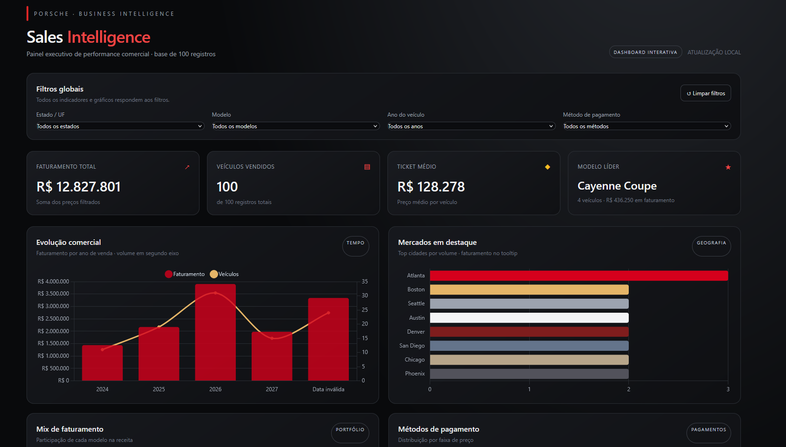

# Porsche | Executive Sales Intelligence Dashboard

Este projeto consiste em uma dashboard interativa de inteligência de vendas desenvolvida para analisar uma base de dados de 100 vendas sanitizadas da Porsche. A aplicação foi construída em um único arquivo HTML standalone, com design executivo em "Dark Mode" e hospedada via **GitHub Pages**.

**Link da Dashboard Publicada:** `https://talithabarcellos.github.io/porsche-sales-dashboard/`

---

## Perguntas de Negócio Respondidas

A dashboard foi projetada para atender à tomada de decisão executiva, respondendo centralmente às seguintes perguntas de negócio:

1. **Evolução do Faturamento & Volume:** Como o faturamento total e o volume de vendas evoluem ao longo dos anos de registro?
2. **Distribuição Geográfica de Vendas:** Quais são as principais cidades/regiões com maior volume de veículos comercializados e receita gerada?
3. **Participação de Portfólio (Mix de Vendas):** Qual é a representatividade de cada modelo (ex: 911, Taycan, Cayenne, Macan, Panamera) no faturamento total da marca?
4. **Perfil Financeiro & Métodos de Pagamento:** Como os métodos de pagamento (Financiamento, Transferência, Cartão, Cripto, etc.) se distribuem em relação às faixas de preço dos veículos comercializados?

---

## Tratamento e Preparação da Base de Dados

Antes do envio dos dados para a criação do painel via Inteligência Artificial, a planilha original passou por um processo de higienização e padronização:

- **Seleção de Colunas Sanitizadas:** Utilizou-se estritamente as colunas com dados sanitizados (`PorscheModelSanitized`, `SalesPriceSanitized`, `ModelYearSanitized`, `PayMethodSanitized`, `CitySanitized`, `StateSanitized`, `SaleDateSanitized`).
- **Conversão de Tipos:** Valores numéricos (Preço e Ano) foram formatados como números limpos sem fórmulas quebradas.
- **Tratamento de Anomalias/Valores Inválidos:** Registros marcados como `INVALID` na data de venda foram mantidos e categorizados explicitamente nos agrupamentos temporais, garantindo integridade e ausência de perda de receita nos KPIs totais.

---

## Uso da IA e Prompts Utilizados

Para o desenvolvimento da dashboard, utilizou-se o modelo **ChatGPT com Canvas** / agente especializado na construção do painel visual.

### Prompt Inicial Utilizado:
> *"Crie uma dashboard interativa completa em um único arquivo HTML (utilizando Tailwind CSS para o design e Chart.js via CDN) para análise de um dataset de 100 vendas da Porsche.*
>
> *A interface deve ser moderna, limpa, no estilo 'Dark Mode' de luxo (fundo escuro, detalhes em cinza chumbo e elementos de destaque em vermelho clássico da marca), focada em executivos.*
>
> *Requisitos da Interface:*
> *- **Painel de Filtros Globais:** UF, Modelo, Ano e Método de Pagamento.*
> *- **Cards de KPIs:** Faturamento Total, Veículos Vendidos, Ticket Médio e Modelo Líder.*
> *- **Gráficos Interativos:** Evolução temporal (Barra/Linha), Top Cidades (Barra Horizontal), Mix de Faturamento por Modelo (Donut) e Métodos de Pagamento por faixa de preço (Colunas Empilhadas).*
> *- **Tabela Detalhada:** Com paginação, busca dinâmica e formatação monetária em Reais (R\$).*
> *- **Requisito Técnico:** Arquivo único (single-file HTML), autossuficiente, com recálculo dinâmico via JavaScript ao aplicar filtros."*

### Refinamentos e Ajustes Manuais em Linguagem Natural:
- Ajuste da escala e formatação do tooltip para exibir valores monetários padronizados em `R$`.
- Inclusão do KPI e cálculo de **Modelo Líder** (modelo com maior volume/faturamento na seleção ativa).
- Implementação de um campo de busca textual no detalhamento da tabela para rápida navegação por modelo ou cidade.
- Tratamento de exceção para vendas com datas no padrão `INVALID` para não quebrar a renderização gráfica da linha do tempo.

---

## Tecnologias Utilizadas

- **HTML5 & JavaScript (ES6+):** Lógica de filtragem dinâmica, manipulação do DOM e agregação de dados em tempo real.
- **Tailwind CSS (CDN):** Estilização responsiva e tema executivo Dark Mode.
- **Chart.js (CDN):** Renderização de gráficos interativos e responsivos.
- **GitHub Pages:** Hospedagem e publicação web do projeto.

---

## Screenshot da Aplicação



---

## Como Executar o Projeto Localmente

1. Clone este repositório:
   ```bash
   git clone [https://github.com/talithabarcellos/porsche-sales-dashboard.git](https://github.com/talithabarcellos/porsche-sales-dashboard.git)

## Autoria

Projeto desenvolvido por Talitha Barreyra Barcellos como parte do curso de Aceleração: AI Reports com Excel, GPT Agents e Claude Code 2º Semestre da DIO.
